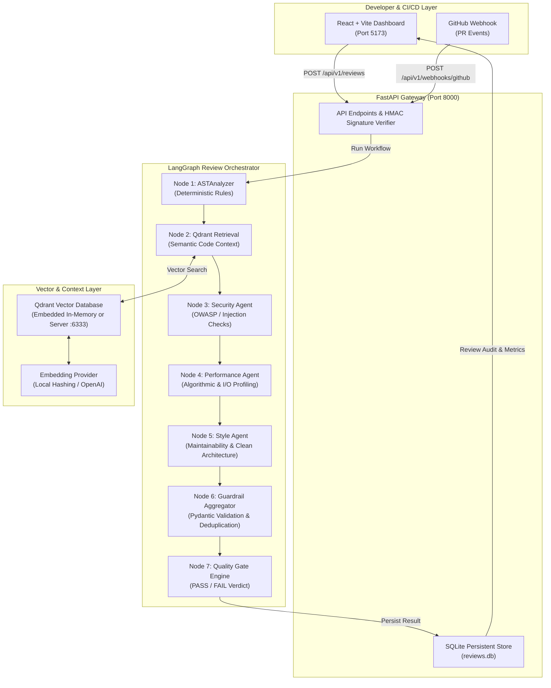

# Multi-Agent Enterprise Code Reviewer & PR Quality Gate

An enterprise-grade, multi-agent code inspection system and automated Pull Request quality gate built with **FastAPI**, **LangGraph**, **Python AST analysis**, **Qdrant Vector Database**, and **React + TypeScript + Vite**.

The application automatically inspects source code changes, flags security vulnerabilities (injection, hardcoded secrets, unsafe dynamic evaluation, command injection), diagnoses performance bottlenecks (quadratic loops, inefficient membership checks, unclosed files, sync blocking I/O in async routines), enforces style standards (mutable defaults, excessive arguments, broad exceptions), retrieves semantic codebase context, and evaluates configurable quality gate policies (PASS, FAIL, INCOMPLETE, ERROR).

---

## 1. Problem Statement

Modern software engineering teams face three primary challenges when reviewing code:
1. **Human Fatigue & Bottlenecks:** Pull requests sit waiting for peer reviews, and critical vulnerabilities (e.g., SQL injection, dynamic `eval()`, hardcoded credentials) slip into production.
2. **Fragility of Pure LLM Approaches:** Unconstrained LLMs frequently hallucinate nonexistent line numbers, invent fictitious APIs, or miss deterministic syntax errors.
3. **Lack of Repository Context:** Single-file diff reviews miss cross-file dependencies and repository conventions.

**Multi-Agent Enterprise Code Reviewer & PR Quality Gate** solves this by pairing **deterministic AST static analysis guardrails** with **LangGraph-coordinated specialized AI agents** and **Qdrant semantic vector retrieval**. It runs locally out-of-the-box in local demonstration mode without external API keys, while scaling seamlessly to live GitHub webhook PR evaluation and OpenAI-compatible LLM endpoints.

---

## 2. Key Features

- **Multi-Agent Coordination via LangGraph:**
  - **Security Agent:** Inspects injection risks, dynamic execution (`eval`/`exec`), credential exposure, unsafe subprocess usage, and OWASP Top 10 guidelines.
  - **Performance Agent:** Pinpoints quadratic loops, repeated regex compilations, linear list lookups inside loops, and blocking I/O in async routines.
  - **Style & Maintainability Agent:** Detects mutable default arguments, overly complex signatures, overly long functions, and broad exception suppression.
- **Deterministic Python AST Engine:**
  - Real structural code analysis using Python's native `ast` module.
  - Safe: **Never executes, evals, or modifies submitted source code**.
  - Graceful syntax error handling reporting exact line and offset diagnostics.
- **Qdrant Semantic Codebase Retrieval:**
  - Indexes local code repositories into token-chunked vector representations.
  - Dual operational modes: Real embedded in-memory Qdrant (`QdrantClient(":memory:")`) for zero-dependency local runs, and remote Qdrant server support for Docker.
  - Embeddings abstraction: Offline deterministic 384-dimensional hypersphere projection and optional OpenAI embeddings.
- **Configurable Quality Gate:**
  - Configurable policy thresholds (`block_on_critical`, `block_on_high`, `max_medium_allowed`, `max_low_allowed`).
  - Clear gate verdicts: `PASS`, `FAIL`, `INCOMPLETE`, or `ERROR` with blocking violations breakdown.
- **GitHub Pull Request Webhook Integration:**
  - HMAC-SHA256 signature verification (`X-Hub-Signature-256`).
  - PR event handling (`opened`, `synchronize`, `reopened`) with replay deduplication.
  - Safe dry-run mode generating inline review comments without posting to GitHub unless authorized.
- **Persistent SQLite Audit Log:**
  - Full review history and aggregated metrics (pass rates, severity distribution, category counts) persisted across restarts.
- **Modern Responsive Dashboard:**
  - Overview metrics, interactive code editor with sample demo presets, repository indexing UI, semantic code search, and live PR webhook simulator.

---

## 3. Architecture



---

## 4. Technology Stack

| Layer | Technologies |
| :--- | :--- |
| **Backend** | Python 3.12, FastAPI 0.162, Uvicorn 0.54, Pydantic v2 (2.14), Pydantic Settings |
| **Agent Orchestration** | LangGraph 1.2, LangChain Core 1.7 |
| **Static Code Analysis** | Python `ast` Abstract Syntax Tree module (Deterministic Engine) |
| **Vector Database** | Qdrant Client 1.20 (Embedded `:memory:` mode & Server mode) |
| **Embeddings** | Deterministic 384-dimensional Token Projection (Local) / OpenAI Embeddings |
| **Persistence** | SQLite 3 (`backend/app/data/reviews.db`) |
| **Frontend** | React 19, TypeScript 5.8, Vite 8.3, Tailwind CSS v4, Lucide Icons |
| **Testing** | Pytest 9.2, Pytest-Asyncio 1.4, Starlette/FastAPI TestClient, Httpx |
| **DevOps** | Docker, Docker Compose, Nginx Alpine, GitHub Actions CI |

---

## 5. Folder Structure

```
multi-agent-code-reviewer/
├── backend/
│   ├── app/
│   │   ├── __init__.py
│   │   ├── main.py                     # FastAPI application & middleware
│   │   ├── config.py                   # Pydantic Settings configuration
│   │   ├── api/
│   │   │   ├── routes_health.py        # /health diagnostic endpoint
│   │   │   ├── routes_review.py        # /api/v1/reviews endpoints
│   │   │   ├── routes_index.py         # /api/v1/index & /api/v1/search
│   │   │   └── routes_webhooks.py      # /api/v1/webhooks/github PR handler
│   │   ├── agents/
│   │   │   ├── security_agent.py       # Specialized Security Agent
│   │   │   ├── performance_agent.py    # Specialized Performance Agent
│   │   │   ├── style_agent.py          # Specialized Style Agent
│   │   │   └── shared.py               # Findings deduplication logic
│   │   ├── workflow/
│   │   │   ├── graph.py                # LangGraph StateGraph compilation
│   │   │   ├── state.py                # TypedDict review workflow state
│   │   │   └── nodes.py                # LangGraph orchestration nodes
│   │   ├── analysis/
│   │   │   ├── ast_analyzer.py         # AST parser & coordinator
│   │   │   ├── security_rules.py       # Deterministic security visitors
│   │   │   ├── performance_rules.py    # Deterministic performance visitors
│   │   │   └── style_rules.py          # Deterministic style & PEP 8 visitors
│   │   ├── retrieval/
│   │   │   ├── embeddings.py           # Local deterministic & OpenAI vectorizers
│   │   │   ├── qdrant_store.py         # Qdrant client adapter (embedded/server)
│   │   │   └── code_indexer.py         # Safe directory scanner & chunker
│   │   ├── services/
│   │   │   ├── review_service.py       # Review orchestration & persistence
│   │   │   ├── quality_gate.py         # Threshold policy evaluation
│   │   │   ├── llm_service.py          # OpenAI-compatible API adapter
│   │   │   └── storage.py              # SQLite review storage & metrics
│   │   ├── schemas/
│   │   │   ├── review.py               # Pydantic models & validation rules
│   │   │   ├── index.py                # Indexing & search models
│   │   │   └── webhook.py              # GitHub webhook schemas
│   │   └── security/
│   │       └── webhook_verification.py # HMAC-SHA256 signature verification
│   ├── tests/
│   │   ├── test_health.py              # Diagnostics endpoint tests
│   │   ├── test_ast_analyzer.py        # Static rule detection tests
│   │   ├── test_workflow.py            # LangGraph execution tests
│   │   ├── test_quality_gate.py        # Quality gate PASS/FAIL/ERROR tests
│   │   ├── test_api_reviews.py         # End-to-end API review tests
│   │   ├── test_retrieval.py           # Embeddings & chunking tests
│   │   └── test_webhooks.py            # GitHub signature & PR simulation tests
│   ├── requirements.txt
│   └── Dockerfile
│
├── frontend/
│   ├── src/
│   │   ├── components/                 # Navbar, SeverityBadge, GateStatusBadge
│   │   ├── pages/
│   │   │   ├── OverviewPage.tsx        # Dashboard metrics & review audit log
│   │   │   ├── CodeReviewPage.tsx      # Code editor, presets & findings breakdown
│   │   │   ├── RepositoryIndexPage.tsx # Local codebase indexer & vector search
│   │   │   ├── GitHubIntegrationPage.tsx# Webhook setup & PR simulator
│   │   │   └── SettingsPage.tsx        # Threshold settings & system diagnostics
│   │   ├── services/
│   │   │   └── api.ts                  # Typed client for backend REST API
│   │   ├── types/
│   │   │   └── review.ts               # Shared TypeScript domain models
│   │   ├── App.tsx                     # Main layout & navigation
│   │   └── main.tsx                    # React DOM entrypoint
│   ├── nginx.conf                      # Docker production proxy configuration
│   ├── package.json
│   └── Dockerfile
│
├── .github/
│   └── workflows/
│       └── ci.yml                      # Automated GitHub Actions test pipeline
│
├── docker-compose.yml                  # Multi-container orchestration
├── .env.example                        # Template configuration file
├── .gitignore
├── pytest.ini
└── README.md
```

---

## 6. Deterministic Static Analysis Rules

The application implements structural AST visitors across three major categories:

### Security Rules
- **`SEC001` (Critical):** Detects `eval()` on dynamic or untrusted expressions.
- **`SEC002` (Critical):** Detects `exec()` on dynamic code strings.
- **`SEC003` (Critical / High):** Detects `subprocess` execution with `shell=True` or direct `os.system()` / `os.popen()` command concatenation.
- **`SEC004` (High):** Flags hardcoded API keys, secrets, access tokens, and passwords assigned string literals (masking snippets in reports).
- **`SEC005` (High):** Identifies dynamic SQL query construction via f-strings or string concatenation (`+`).
- **`SEC006` (High):** Detects unsafe deserialization (`pickle.loads()` or `yaml.load()` without SafeLoader).
- **`SEC007` (Medium):** Detects cryptographically broken hashing algorithms (`md5`, `sha1`).

### Performance Rules
- **`PERF001` (Medium):** Repeated string concatenation (`+=`) inside `for` or `while` loops (O(N²) memory allocation).
- **`PERF002` (Low):** Repeated linear membership test (`item in [...]`) inside loops.
- **`PERF003` (Low):** File opened via `open()` without a `with` context manager.
- **`PERF004` (Medium):** Repeated regex pattern compilation (`re.compile`) inside loop bodies.
- **`PERF005` (High):** Synchronous blocking I/O calls (`time.sleep`, `requests.get`) inside `async def` functions.

### Style & Maintainability Rules
- **`STY001` (Medium / Low):** Bare `except:` or broad `except Exception:` silently suppressing errors with `pass`.
- **`STY002` (High):** Mutable default arguments in function definitions (`def fn(items=[])`).
- **`STY003` (Medium):** Functions with excessive parameters (> 6 parameters).
- **`STY004` (Low):** Overly long functions (> 60 lines of code).
- **`STY005` (Low):** Function names violating PEP 8 `snake_case` naming conventions.

---

## 7. Local Setup (Without Docker)

### Prerequisites
- Python 3.11+ (Python 3.12 recommended)
- Node.js 18+ (Node 22 recommended)
- Git

### 1. Backend Setup
```bash
# Navigate to backend directory
cd backend

# Create and activate a Python virtual environment
python -m venv .venv

# On Linux/macOS:
source .venv/bin/activate
# On Windows (PowerShell):
.venv\Scripts\Activate.ps1

# Install backend dependencies
pip install -r requirements.txt

# Start the FastAPI server (runs with embedded Qdrant and local embeddings by default)
uvicorn app.main:app --host 0.0.0.0 --port 8000 --reload
```
The backend API is now running at `http://localhost:8000`. Interactive OpenAPI documentation is available at `http://localhost:8000/docs`.

### 2. Frontend Setup
In a new terminal window:
```bash
# Navigate to frontend directory
cd frontend

# Install dependencies
npm install

# Start the Vite development server
npm run dev
```
Open your browser at `http://localhost:5173`.

---

## 8. Docker Setup

To run the full stack (FastAPI Backend + React Frontend + Qdrant Vector Database) in Docker containers:

```bash
# 1. Copy environment template
cp .env.example .env

# 2. Build and start containers with Docker Compose
docker compose up --build -d
```

### Container Endpoints:
- **Frontend Dashboard:** `http://localhost:5173`
- **Backend API & Health:** `http://localhost:8000/health`
- **Interactive Swagger Docs:** `http://localhost:8000/docs`
- **Qdrant Vector Database:** `http://localhost:6333`

To stop the containers:
```bash
docker compose down
```

---

## 9. Environment Variables Configuration

| Variable | Default | Purpose |
| :--- | :--- | :--- |
| `OPENAI_API_KEY` | *(None)* | Optional API key for OpenAI-assisted agent reviews. |
| `OPENAI_BASE_URL` | `https://api.openai.com/v1` | Custom endpoint for OpenAI-compatible LLMs (vLLM, Ollama, Groq). |
| `OPENAI_MODEL` | `gpt-4o-mini` | Chat model name for agent evaluation. |
| `QDRANT_MODE` | `embedded` | `embedded` (in-memory, no external service) or `server` (connects via network). |
| `QDRANT_HOST` | `localhost` | Qdrant daemon host when in server mode. |
| `QDRANT_PORT` | `6333` | Qdrant daemon port. |
| `EMBEDDING_PROVIDER` | `local` | `local` (deterministic offline 384-dim hash projection) or `openai`. |
| `GITHUB_WEBHOOK_SECRET` | *(None)* | Shared secret for verifying GitHub webhook HMAC-SHA256 signatures. |
| `GITHUB_TOKEN` | *(None)* | GitHub Personal Access Token for posting comments to live PRs. |
| `GITHUB_DRY_RUN` | `true` | When `true`, formats review comments without publishing them to GitHub. |
| `GATE_BLOCK_ON_CRITICAL` | `true` | Fails the quality gate if any Critical finding is reported. |
| `GATE_BLOCK_ON_HIGH` | `true` | Fails the quality gate if any High severity finding is reported. |
| `GATE_MAX_MEDIUM` | `5` | Maximum allowed Medium findings before gate failure. |

---

## 10. Running Automated Tests

The test suite contains **31 automated tests** covering health diagnostics, AST static analysis, LangGraph workflow execution, Quality Gate evaluation, API endpoints, Qdrant retrieval, and GitHub webhook verification:

```bash
# Run pytest test suite from project root
pytest backend/tests/ -v
```

### Test Coverage Highlights:
- **`test_ast_analyzer.py` (8 tests):** Validates detection of `eval`, `exec`, `subprocess.run(shell=True)`, hardcoded credentials, SQL injection patterns, loop string concatenation, unclosed files, mutable defaults, and syntax errors.
- **`test_quality_gate.py` (6 tests):** Validates clean `PASS`, `FAIL` on Critical/High, threshold overrides, `ERROR` on syntax errors, and `INCOMPLETE` on analysis failures.
- **`test_health.py` (2 tests):** Validates diagnostic component reporting without API keys.
- **`test_workflow.py` (2 tests):** Exercises LangGraph state transitions and node executions.
- **`test_api_reviews.py` (5 tests):** Validates submission, 422 on empty code, schema errors, persistence in SQLite, and metrics calculations.
- **`test_retrieval.py` (4 tests):** Validates L2-normalized 384-dimensional vector embedding, file chunking, directory traversal security, and semantic search.
- **`test_webhooks.py` (4 tests):** Validates HMAC-SHA256 signature verification, replay protection, ping handling, and dry-run PR comment generation.

---

## 11. API Endpoints

### Health & Diagnostics
- `GET /health`  
  Returns overall service health, operating mode (`production` vs `local-demonstration`), vector database mode, and provider statuses.

### Code Reviews
- `POST /api/v1/reviews`  
  Submits Python code for inspection.  
  *Request:*
  ```json
  {
    "code": "eval(user_input)\n",
    "file_path": "auth.py",
    "scope": "ALL",
    "enable_llm": false
  }
  ```
  *Response (201 Created):*
  ```json
  {
    "review_id": "8f2a1b9c-...",
    "timestamp": "2026-10-29T10:00:00Z",
    "file_path": "auth.py",
    "scope": "ALL",
    "findings": [
      {
        "id": "e4b1a2c3-...",
        "rule_id": "SEC001",
        "category": "SECURITY",
        "severity": "CRITICAL",
        "title": "Unsafe dynamic execution via eval()",
        "explanation": "eval() parses and executes arbitrary Python expressions...",
        "remediation": "Replace eval() with safe alternatives like ast.literal_eval()...",
        "line_number": 1,
        "source": "AST",
        "confidence": 0.95
      }
    ],
    "quality_gate": {
      "status": "FAIL",
      "summary": "Quality Gate FAILED: 1 blocking issue(s) identified.",
      "blocking_findings": [...],
      "severity_counts": { "CRITICAL": 1, "HIGH": 0, "MEDIUM": 0, "LOW": 0, "INFO": 0 },
      "explanation": "Quality gate blocked by the following policy triggers: 1 Critical finding(s) detected..."
    },
    "execution_metadata": {
      "duration_ms": 14.2,
      "deterministic_ast_ran": true,
      "llm_agents_ran": false
    }
  }
  ```

- `GET /api/v1/reviews/{review_id}`  
  Retrieves a past code review by UUID.

- `GET /api/v1/reviews`  
  Lists paginated code review summaries.

- `GET /api/v1/reviews/metrics/summary`  
  Returns total reviews, pass rate, failed gates count, and severity distributions.

### Repository Indexing & Semantic Search
- `POST /api/v1/index`  
  Indexes a local project directory into Qdrant code chunks.
- `GET /api/v1/index/status`  
  Returns current chunk counts and vector store mode.
- `POST /api/v1/search`  
  Executes semantic similarity search over indexed code chunks.

### GitHub Integration
- `GET /api/v1/webhooks/github/status`  
  Returns GitHub integration configuration status.
- `POST /api/v1/webhooks/github`  
  Receives and verifies GitHub Pull Request webhook payloads.

---

## 12. Security Considerations

1. **No Code Execution:** The analyzer uses Python's Abstract Syntax Tree parser. It **never runs, evals, or executes submitted code**.
2. **Directory Traversal Defense:** The repository indexer rejects root paths (`/`, `C:\`, `C:\Windows`) and forbids path traversal.
3. **Sensitive File Exclusions:** File indexers automatically skip `.env`, private keys (`id_rsa`), credential JSONs, `__pycache__`, and virtual environments.
4. **Untrusted Data Handling:** Code snippets and retrieved context are treated as strictly untrusted text data and prevented from overriding prompt instructions.
5. **No Secret Leakage:** Findings masking replaces credential values with asterisks in snippet previews.
6. **Dry-Run by Default:** The GitHub webhook integration operates in dry-run mode unless explicitly configured with live credentials.

---

## 13. Known Limitations & Future Enhancements

### Known Limitations
- Static AST analysis currently focuses on Python (`.py`) source code. Polyglot support (TypeScript, Go, Rust) requires tree-sitter bindings.
- Multi-file semantic retrieval relies on local project directory indexing; remote repository indexing requires cloning or GitHub tree API access.

### Future Enhancements
- Tree-sitter integration for multi-language AST inspection (TypeScript, Java, Go).
- Auto-generated remediation pull requests with user approval workflows.
- Integration with GitLab Merge Requests and Bitbucket Pipelines.
